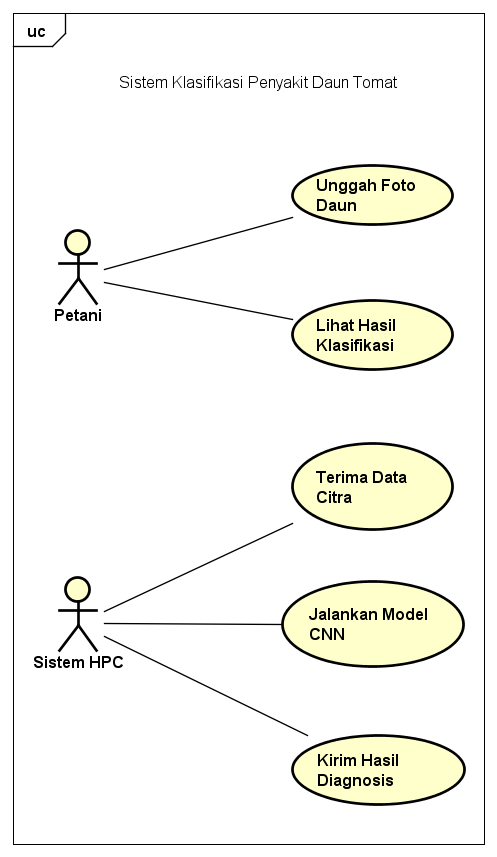

# 🍅 Bridging Global Infrastructure to Address Local Challenge: Tomato Leaf Disease Classification with HPC

**Studi Kasus Implementasi Materi Kuliah Umum: High Performance Computing (HPC)**  
*Berdasarkan kuliah umum oleh Asst. Prof. Dr. Worawan Diaz Carballo*

---

## 🌍 Latar Belakang: Menghubungkan Infrastruktur Global dan Masalah Lokal
Sesuai dengan gagasan Dr. Worawan mengenai *Bridging Global Infrastructure to Address Local Challenge*, proyek ini dirancang sebagai simulasi peran seorang **Integrator**. Seorang integrator bertugas menghubungkan kebutuhan di tingkat lokal dengan kemampuan infrastruktur komputasi kelas dunia (Superkomputer/HPC).

**Masalah Lokal (*Local Challenge*):**  
Di sektor agrikultur lokal, petani sering kali mengalami gagal panen akibat penyakit pada daun tomat yang terlambat didiagnosis secara manual. (Ini relevan dengan contoh proyek "DigiFarm" pada kuliah umum).

**Solusi Infrastruktur (*Global Infrastructure*):**  
Menerapkan *Convolutional Neural Network* (CNN) berbasis *Deep Learning* untuk klasifikasi gambar daun otomatis. Karena model CNN membutuhkan daya komputasi tinggi (kalkulasi *floating-point* atau FLOPS yang masif), proses pelatihan (*training*) harus dijalankan pada infrastruktur HPC yang dilengkapi GPU.

---

## 🛠️ Arsitektur Sistem dan Workflow Integrasi
Sebagai seorang integrator, alur kerja dibagi menjadi persiapan data lokal, perancangan model, dan eksekusi pada superkomputer.

### 1. Diagram Use Case (Perancangan Sistem)
Diagram ini memvisualisasikan bagaimana petani (lokal) berinteraksi dengan sistem HPC yang mengelola model kecerdasan buatan.

*(Pastikan gambar diagram Anda bernama `use_case_diagram.png` di repositori Anda, atau sesuaikan nama file di bawah ini)*


### 2. HPC Workflow Simulation
Proyek ini memisahkan skrip menjadi dua bagian utama yang mencerminkan cara kerja fasilitas superkomputer sungguhan:

*   **`train_cnn_model.py` (Domain Science):**  
    Berisi arsitektur *Artificial Intelligence* (model sekuensial CNN) yang menyimulasikan klasifikasi 10 jenis kondisi daun tomat menggunakan dataset *PlantVillage*.
*   **`run_job.sh` (HPC Integration):**  
    Simulasi *batch script* SLURM. Di lingkungan HPC sungguhan (seperti superkomputer *Lanta* atau *Fugaku*), program tidak dijalankan melalui klik ganda (*double-click*), melainkan dikirim sebagai *job* ke *Node* komputasi (GPU) menggunakan baris perintah (CLI) berbasis Linux.

---

## 🚀 Cara Menjalankan Simulasi (Environment Pengganti HPC)
Karena keterbatasan akses fisik ke kluster superkomputer, eksekusi skrip ini disimulasikan menggunakan infrastruktur *Cloud GPU* dari **Google Colab**.

1. Unduh skrip `train_cnn_model.py` dari repositori ini.
2. Buka platform [Google Colab](https://colab.research.google.com/).
3. Buat *Notebook* baru dan ubah tipe *runtime* (*Hardware Accelerator*) menjadi **GPU** (T4) untuk mereplikasi tenaga HPC.
4. Unggah skrip Python ke Google Colab dan jalankan menggunakan perintah terminal Bash untuk mensimulasikan lingkungan Linux (*environment* asli HPC):
   ```bash
   !python train_cnn_model.py
